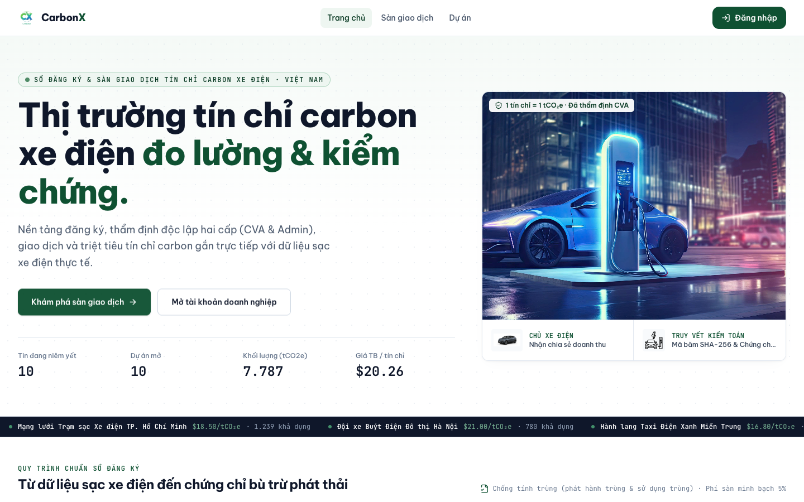
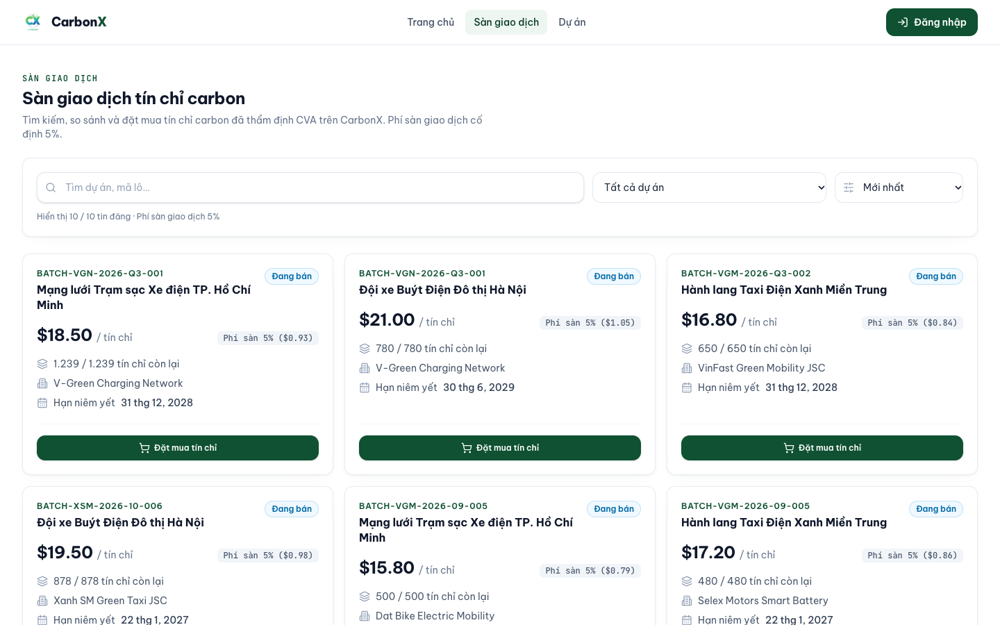
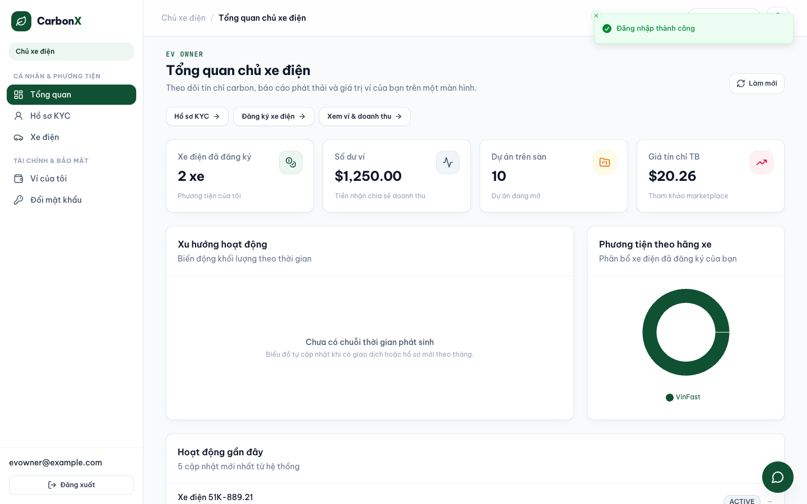
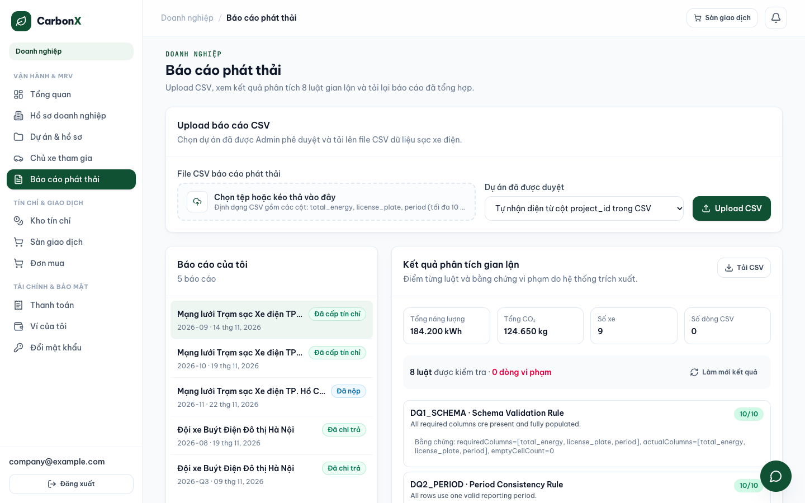
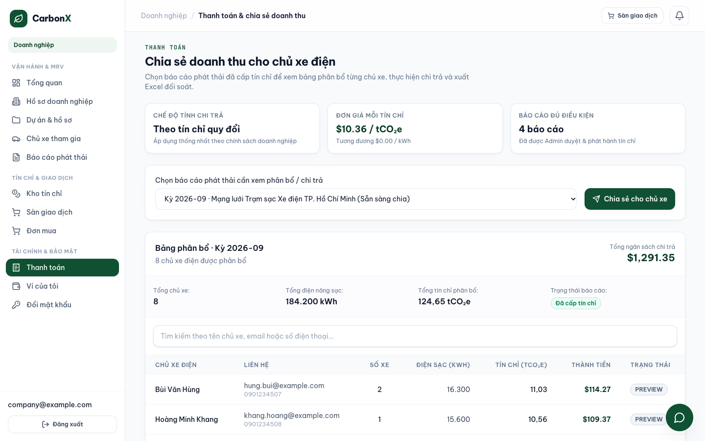
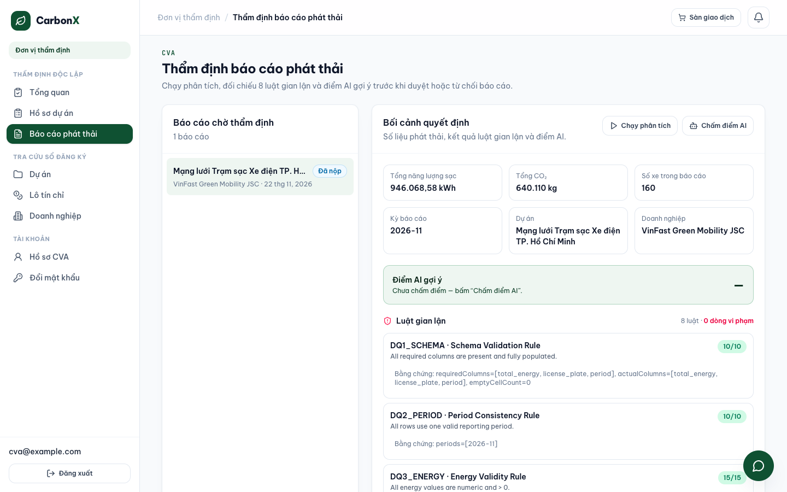
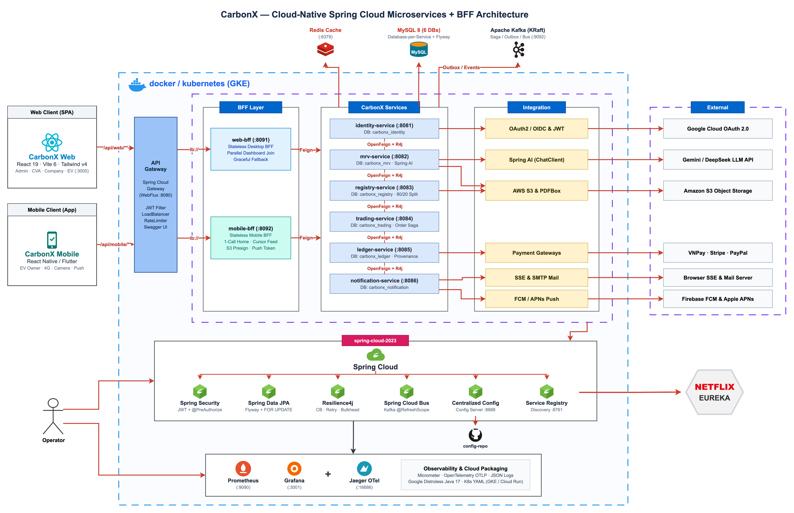

# CarbonX — Carbon Credit Marketplace

Sàn giao dịch tín chỉ carbon: chủ xe điện tạo ra dữ liệu giảm phát thải, doanh nghiệp gom dữ liệu đó thành dự án, đơn vị thẩm định (CVA) và Admin duyệt, tín chỉ được phát hành, bán trên sàn và doanh thu được chia lại cho từng chủ xe.

Nguyên tắc cốt lõi của backend: **mọi thay đổi số dư ví đều đi kèm một dòng `WalletTransaction` bất biến ghi số dư trước và sau.**

Spring Boot 3.3 / Java 17 / MySQL 8 · React 19 + Vite 6 + Tailwind 4 + TypeScript · Docker Compose



---

## Ảnh chụp giao diện

<table>
  <tr>
    <td align="center">
      <br>
      <sub><b>Sàn giao dịch tín chỉ carbon công khai</b></sub>
    </td>
    <td align="center">
      <br>
      <sub><b>Tổng quan Chủ xe điện (KPI, Donut, Hoạt động)</b></sub>
    </td>
  </tr>
  <tr>
    <td align="center">
      <br>
      <sub><b>Báo cáo phát thải CSV & 8 luật kiểm tra gian lận</b></sub>
    </td>
    <td align="center">
      <br>
      <sub><b>Chia sẻ doanh thu (Profit Sharing) theo kWh / tCO₂e</b></sub>
    </td>
  </tr>
  <tr>
    <td align="center" colspan="2">
      <br>
      <sub><b>Màn hình Thẩm định độc lập CVA (8 luật gian lận + Chấm điểm AI)</b></sub>
    </td>
  </tr>
</table>

## Vai trò

| Vai trò | Làm gì |
|---|---|
| **Chủ xe điện (EV Owner)** | Đăng ký KYC và xe, nhận tiền chia sẻ doanh thu vào ví, xem tiền thuộc lô tín chỉ nào |
| **Doanh nghiệp (Company)** | Đăng ký dự án, nộp báo cáo phát thải, giữ kho tín chỉ, đăng bán/mua, chia doanh thu cho chủ xe |
| **CVA** | Thẩm định hồ sơ dự án và báo cáo phát thải (không có ví tiền) |
| **Admin** | Tạo dự án, duyệt hồ sơ cấp 2, phát hành tín chỉ, duyệt rút tiền, quản lý người dùng và xe |

## Luồng nghiệp vụ chính

1. Admin tạo dự án → Doanh nghiệp đăng ký tham gia → CVA thẩm định → Admin duyệt.
2. Doanh nghiệp nộp báo cáo phát thải (dữ liệu của các chủ xe) → CVA thẩm định → Admin duyệt.
3. Admin phát hành lô tín chỉ (công thức VM0038, mỗi lô có mã lô và dải serial; lô đã phát hành không đổi khi quy tắc dự án thay đổi sau này).
4. Doanh nghiệp đăng bán trên sàn, doanh nghiệp khác mua và thanh toán bằng ví.
5. Doanh nghiệp chia doanh thu: tiền chuyển vào ví từng chủ xe theo kWh sạc thực tế, kèm bảng chi tiết từng người.
6. Chủ xe rút tiền, Admin duyệt lệnh rút.

## Kiến trúc Microservices & BFF (Cloud-Native Spring Cloud)



- **2 Kênh Client & Tầng BFF không trạng thái (Stateless BFF)**:
  - `web-bff` (`:8091`, `/api/web/**`): Tổng hợp song song dữ liệu đa dịch vụ cho **Web SPA** (`React 19`) kèm cơ chế suy giảm êm (`partialData = true`).
  - `mobile-bff` (`:8092`, `/api/mobile/**`): Tối ưu payload JSON gọn nhẹ cho **Mobile App** (`React Native / Flutter`) trên mạng 4G/5G, gộp 1 request màn hình chính, cấp **Presigned S3 URL** chụp ảnh KYC/cà-vẹt xe trực tiếp từ camera và quản lý **FCM / APNs Push Token**.
- **Hạ tầng Phân tán Spring Cloud (`2023.0.3`)**: `discovery-server` (**Netflix Eureka** `:8761`), `config-server` (**Spring Cloud Config + Bus Kafka** `:8888`), `api-gateway` (**Spring Cloud Gateway WebFlux** `:8080` + LoadBalancer + Swagger UI tập trung), giao tiếp nội bộ qua **OpenFeign + Resilience4j** (`CircuitBreaker`, `Retry`, `Bulkhead`, `RateLimiter`).
- **6 Domain Microservices (Database-per-Service + Flyway + DDD/CQRS + Saga + Outbox)**: `identity-service` (`:8081`), `mrv-service` (`:8082` tích hợp **Spring AI `ChatClient`**), `registry-service` (`:8083` + **Redis** cache + tách `CreditHoldings` 80/20), `trading-service` (`:8084` **Order Saga** + Compensating Transactions), `ledger-service` (`:8085` sổ cái bất biến + truy vết `PayoutItems`), `notification-service` (`:8086` **Apache Kafka** + SSE + Mail + Push).

```
backend/                   Maven Multi-Module Reactor (12 modules: Eureka, Config, Gateway, 2 BFFs, 6 Services)
frontend/                  React 19 SPA (Vite 6, Tailwind v4, React Query, Zustand)
mobile/                    React Native Expo TypeScript Skeleton (DDD / Logical CQRS khớp 1-1 với mobile-bff)
config-repo/               Cấu hình tập trung cho Spring Cloud Config Server
k8s/                       Manifest Kubernetes (ConfigMap, Secret, Deployment, Service) cho GKE / Cloud Run
monitoring/                Prometheus, Grafana provisioning & MySQL 6-DB init script
docker-compose.yml         Full stack: 6-DB MySQL 8 + Redis + Kafka KRaft + Spring Cloud + BFF + Observability
docs/                      Kiến trúc, ERD từng service, kiểm toán bảo mật, prompt triển khai, ảnh & video demo
```

## Tài liệu kỹ thuật & Kiểm toán (`docs/`)

| Tài liệu | Nội dung |
|---|---|
| [ARCHITECTURE_AUDIT.md](docs/ARCHITECTURE_AUDIT.md) | Đánh giá tổng thể kiến trúc, điểm nóng kỹ thuật và kế hoạch chuẩn hoá |
| [00_AUDIT_INDEX.md](docs/architecture/00_AUDIT_INDEX.md) | Chỉ mục 30 tài liệu kiểm toán chuyên sâu trong `docs/architecture/` |
| [21_MONEY_INVARIANTS_AUDIT.md](docs/architecture/21_MONEY_INVARIANTS_AUDIT.md) | Bất biến tài chính & sổ cái `WalletTransaction` |
| [23_CONCURRENCY_TRANSACTION_AUDIT.md](docs/architecture/23_CONCURRENCY_TRANSACTION_AUDIT.md) | Phân tích khoá bi quan (`FOR UPDATE`) & giao dịch đa luồng |
| [20_PAYMENT_STATE_MACHINE_AUDIT.md](docs/architecture/20_PAYMENT_STATE_MACHINE_AUDIT.md) | Máy trạng thái thanh toán (VNPay / Stripe / PayPal) & rút tiền |
| [SECURITY_AUDIT.md](docs/security/SECURITY_AUDIT.md) | Báo cáo kiểm toán bảo mật OWASP Top 10 & các bản vá đã áp dụng |
| [remediation/README.md](docs/remediation/README.md) | Lộ trình khắc phục P0 / P1 / P2 & bài học vận hành |

- Xác thực JWT, phân quyền theo vai trò ở cả backend (403) lẫn frontend (`RoleGuard`).
- Thông báo thời gian thực qua SSE; thanh toán nạp tiền qua Stripe / PayPal / VNPay.
- Chống thao tác trùng bằng khoá bi quan (`FOR UPDATE`) khi chốt đơn; có test đồng thời với MySQL thật (Testcontainers).

## Video demo

Mỗi luồng tự phát trực tiếp (GIF) ngay bên dưới; bấm vào từng luồng để mở phát thẳng bản MP4 sắc nét:

<table>
  <tr>
    <td align="center">
      <a href="https://raw.githubusercontent.com/LeHuyTuong/carbonx-marketplace/main/docs/demo/flow01_admin_khoi-tao-du-an.mp4">
        <br>
        ▶ 1. Admin khởi tạo dự án (MP4)
      </a>
    </td>
    <td align="center">
      <a href="https://raw.githubusercontent.com/LeHuyTuong/carbonx-marketplace/main/docs/demo/flow02_cva_tham-dinh-ho-so-va-bao-cao.mp4">
        <br>
        ▶ 2. CVA thẩm định hồ sơ và báo cáo (MP4)
      </a>
    </td>
  </tr>
  <tr>
    <td align="center">
      <a href="https://raw.githubusercontent.com/LeHuyTuong/carbonx-marketplace/main/docs/demo/flow03_admin_phe-duyet-va-phat-hanh-tin-chi.mp4">
        <br>
        ▶ 3. Admin phê duyệt và phát hành tín chỉ (MP4)
      </a>
    </td>
    <td align="center">
      <a href="https://raw.githubusercontent.com/LeHuyTuong/carbonx-marketplace/main/docs/demo/flow04_doanh-nghiep_giao-dich-san-va-thanh-toan.mp4">
        <br>
        ▶ 4. Doanh nghiệp giao dịch trên sàn (MP4)
      </a>
    </td>
  </tr>
  <tr>
    <td align="center">
      <a href="https://raw.githubusercontent.com/LeHuyTuong/carbonx-marketplace/main/docs/demo/flow05_doanh-nghiep_chia-se-doanh-thu-profit-sharing.mp4">
        <br>
        ▶ 5. Chia sẻ doanh thu cho chủ xe (MP4)
      </a>
    </td>
    <td align="center">
      <a href="https://raw.githubusercontent.com/LeHuyTuong/carbonx-marketplace/main/docs/demo/flow06_chu-xe-dien_quan-ly-xe-va-vi.mp4">
        <br>
        ▶ 6. Chủ xe quản lý xe và ví (MP4)
      </a>
    </td>
  </tr>
</table>

Toàn bộ file gốc nằm ở [`docs/demo/`](docs/demo/).

## Đa luồng & Chống tranh chấp (Concurrency)

Hệ thống xử lý đồng thời ở 2 điểm nóng tài chính:

1. **Chốt đơn mua tín chỉ (`OrderServiceImpl`)**: Khi nhiều request cùng gọi chốt một đơn hàng, transaction khoá bi quan (`PESSIMISTIC_WRITE` / `SELECT ... FOR UPDATE`) trên đơn hàng, tin đăng và ví người mua/bán, kết hợp kiểm tra trạng thái idempotent — đảm bảo chỉ trừ tiền đúng 1 lần và ghi đúng 1 bộ `WalletTransaction`.
2. **Chia sẻ doanh thu bất đồng bộ (`ProfitSharingServiceImpl` + `ConcurrencyConfig`)**: Khoá dòng `EmissionReport` (`findByIdForUpdate`) để tuần tự hoá lệnh chia tiền, sau đó đẩy việc chuyển khoản từng chủ xe vào thread pool giới hạn (`profitPool`), tách transaction độc lập cho từng chủ xe và dùng `claim_token` + heartbeat để retry không trả trùng.

**Chạy thử đa luồng trực tiếp (8 luồng bắn đồng thời vào 1 đơn hàng):**

```bash
python3 scripts/demo_concurrency.py
```

Kết quả mẫu khi 8 thread cùng qua `Barrier` gọi `POST /api/v1/orders/{id}/complete`:

```text
[Before] Buyer wallet balance = $248295.5
[Order ] Created order #17 (1 credit @ listing #10), launching 8 concurrent threads...

  Thread #01 -> HTTP 200 [OK  ] (  43.5 ms) : Success
  ...
  Thread #08 -> HTTP 200 [OK  ] (  36.4 ms) : Success

[After ] Buyer wallet balance = $248276.0 (debited: $19.5)
[Result] 8/8 threads returned HTTP 200 (1 settled + 7 idempotent no-op under PESSIMISTIC_WRITE); debited $19.5 == 1x order.
```

Integration test đa luồng trên MySQL 8 thật (Testcontainers):

```bash
cd backend/Market_carbon && ./mvnw verify -Dit.test=OrderSettlementConcurrencyIT
```

## Chạy local & Triển khai từng bước

**Bước 1 — Khởi động hạ tầng nền (MySQL 6 DB + Redis + Kafka + Eureka + Config Server + Observability)**

```bash
cp .env.example .env     # điền MYSQL_ROOT_PASSWORD, JWT_SECRET, AI_API_KEY
docker compose up -d mysql redis kafka discovery-server config-server jaeger prometheus grafana
# Eureka :8761 · Config Server :8888 · Jaeger :16686 · Prometheus :9090 · Grafana :3001
```

**Bước 2 — Implement & chạy từng phần**

```bash
# Backend Microservices + BFF (khung DDD/CQRS chuẩn ArchUnit)
cd backend && mvn test -T 1C -B

# Web Frontend (React 19 SPA)
cd frontend && npm install && npm run dev     # http://localhost:5173

# Mobile App (React Native + Expo + TypeScript khớp mobile-bff)
cd mobile && npm install && npm run typecheck && npm test
```

> Lưu ý: Phần lõi 6 microservices nghiệp vụ và 2 BFF hiện đang ở dạng **khung interface DDD/CQRS + Flyway migration** sẵn sàng để triển khai dần theo thứ tự trong [`docs/prompts/DEEPSEEK_PROMPTS.md`](docs/prompts/DEEPSEEK_PROMPTS.md); backend monolith tham chiếu cũ nằm tại [`backend/Market_carbon/`](backend/Market_carbon/).

Biến môi trường tối thiểu xem [`.env.example`](.env.example). Không commit giá trị thật.

## Kiểm thử

```bash
cd backend && mvn test -T 1C -B                  # ArchUnit + 6-State Saga + compile 13 reactor items
cd mobile && npm run typecheck && npm test       # Strict TS + Clean boundary + BFF parity test
cd frontend && npm test && npm run build         # Vitest + typecheck + Vite build
```

## Tài liệu

- Quy chuẩn 10 tầng: [`MASTER-PLAN.md`](MASTER-PLAN.md)
- Sơ đồ kiến trúc & ERD từng service: [`docs/diagrams/microservices-architecture.png`](docs/diagrams/microservices-architecture.png), [`docs/diagrams/conceptual-erd.png`](docs/diagrams/conceptual-erd.png), [`docs/diagrams/services/`](docs/diagrams/services/)
- Bộ prompt triển khai từng service & Mobile: [`docs/prompts/DEEPSEEK_PROMPTS.md`](docs/prompts/DEEPSEEK_PROMPTS.md)
- Tài liệu kiểm toán & bảo mật: [`docs/architecture/`](docs/architecture/), [`docs/security/SECURITY_AUDIT.md`](docs/security/SECURITY_AUDIT.md)

## Tác giả

- **Lê Huy Tường** — Solo Author & Solution Architect ([GitHub @LeHuyTuong](https://github.com/LeHuyTuong))
